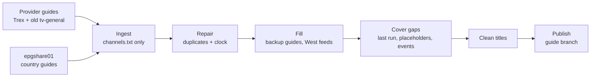

# tv-general

**One clean TV guide for my IPTV playlists.** The tv-general-trex playlist (Trex line) and the old tv-general playlist, while it's still in use, share a single guide that's rebuilt twice an hour by GitHub Actions.

**Guide:** `https://raw.githubusercontent.com/yogzoth/tv-general/guide/epg.xml.gz`. The playlists already point at it, so most apps pick it up on their own.

A provider's own guide is usually close but not quite: late duplicate schedules, a clock that drifts, holes in the overnight hours, no listings at all for West feeds and live-event slots. This repo stitches several guides together into one that's actually complete:

- **Only the channels I watch.** Every source is cut down to the guide IDs in `channels.txt`.
- **A fixed provider guide.** Late duplicate schedules are removed and its clock is checked against CNN.
- **No holes.** Patchy guides are filled from a backup for the same channel, and any remaining gap is covered by the previous run's guide.
- **West feeds.** Built from their East guide, 3 hours later (live games stay at their real time).
- **Live events by name.** Sports and PPV slots show the event that's actually on, and channels with no schedule anywhere get placeholder listings.
- **Clean titles.** Episode details move to the description, and movies get their year.

## Guide links

| Format | Link |
| --- | --- |
| Zipped (smaller, faster) | `https://raw.githubusercontent.com/yogzoth/tv-general/guide/epg.xml.gz` |
| Plain | `https://raw.githubusercontent.com/yogzoth/tv-general/guide/epg.xml` |

The old `epg-merge` links still redirect.

## How it works

A [GitHub Actions workflow](.github/workflows/epg.yml) runs [`merge_epg.py`](merge_epg.py) twice an hour and force-pushes the result to the `guide` branch, which only ever holds the latest files, so the repo never grows. `status.txt` on that branch shows when the guide was last built, what each source gave, and any channel with no listings. If the guide is about to run dry, the workflow opens an issue.

| File | What it is |
| --- | --- |
| `merge_epg.py` | The guide builder |
| `channels.txt` | Every guide ID the two playlists use |
| `shift.txt` | Channels whose stream runs ahead of or behind its guide, in minutes |
| `fill.txt` | Backup guides for channels whose main guide has holes (often the Trex line's own guide) |
| `placeholders.txt` | Simple listings for channels with no schedule anywhere |
| `event_slots.txt` | Which Trex stream each live sports and PPV slot is, so the guide can show the event name |
| `sources_extra.txt` | Extra country guide files used by the World channels |
| `art/` | Logos for the Chill channels, event slots and a few channels the logo library is missing |

## Upkeep

- **Login changes:** `PROVIDER_EPG_URL` is the Trex line's xmltv.php link; `PROVIDER2_EPG_URL` is the old tv-general provider (delete it when that ends). Both live under Settings, Secrets and variables, Actions. Logins are never stored in the repo.
- **Lineup changes:** upload the new `channels.txt`, `placeholders.txt` and `event_slots.txt` together.
- **Manual run:** Actions, Build merged guide, Run workflow. Manual runs also refresh `index.txt`, a list of every channel in every guide source, used to match new channels.
